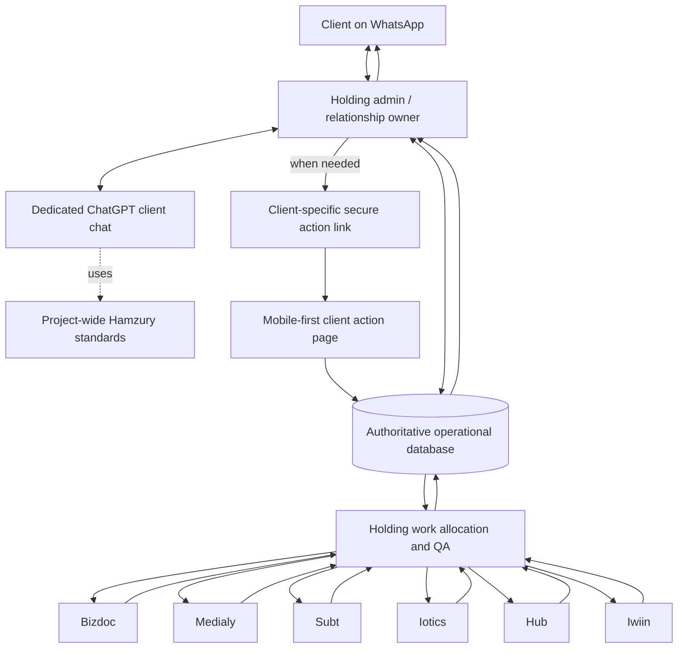

# hamzury holding | full-stack client relationship architecture blueprint

**document id:** HM-ARCH-001  
**version:** 1.0 — enhanced architectural proposal  
**status:** proposed design for review; not a claim of implemented software  
**owner:** hamzury holding  
**primary channel:** whatsapp business  
**experience promise:** *we help businesses move from awareness to success through the right structure, services and systems.*  
**companion reference:** `hamzury-communication-brand-standard.md` (v1.1 working standard)

> **north star:** one client · one relationship · one roadmap · multiple services · one hamzury experience.

---

## 0. executive decision

Hamzury should **not** begin by building a large all-in-one application. Start with the existing WhatsApp Business number and a ChatGPT Project containing **one dedicated chat per client**. Make this manual experience excellent, standardised and measurable. Add an admin-sent **secure action-link layer** only when needed; then add an authoritative operations database, venture workspaces and carefully selected automation.

**The client does not need to find the website.** Holding sends the exact action link into the existing WhatsApp conversation. The website performs a specific job—collect, confirm, approve, track, deliver—then returns the client to WhatsApp. The admin remains the relationship owner.

### 0.1 non-negotiable principles

1. **one institution:** clients deal with Hamzury, not a confusing set of six disconnected businesses.
2. **one client, one ChatGPT chat:** a dedicated working relationship from discovery through renewals and new services; never open a new chat merely because a new venture becomes involved.
3. **one canonical client ID:** many projects, service orders and actions may belong to it.
4. **one next best action:** make the smallest useful decision obvious at each moment.
5. **progressive disclosure:** ask only for information needed now; reuse previously supplied, verified data.
6. **advisor before seller:** diagnose sufficiently, recommend the best fit, give the client genuine control.
7. **human accountability:** AI proposes; authorised staff confirm prices, timelines, payments, compliance claims and delivery.
8. **holding owns client communication and QA; ventures own assigned delivery.**
9. **secure by design:** a client reference number is never an authentication secret.
10. **build once, configure many:** reusable templates, service rules, forms, action links and workflows.
11. **no false progress:** status reflects verified events, not optimistic messages.
12. **no forced bundle:** cross-venture recommendations must follow client need, budget and dependencies.

### 0.2 explicit boundaries

- **today:** WhatsApp Business app + ChatGPT Project; the admin manually copies client messages and approved replies. No assumed WhatsApp API, automated numbered-menu routing or ChatGPT-to-WhatsApp sending.
- **future:** client portal, links, CRM and automations are *design specifications*, not live features.
- **authority:** the approved Hamzury Brand Standard, current approved service catalogue, pricing and SOPs must supersede proposed examples here.
- **not guaranteed:** no software, psychology framework or closing script can guarantee a 99% conversion rate.

---

## 1. institutional architecture

### 1.1 experience, intelligence, operations and delivery



**Important:** the dashed ChatGPT knowledge link is conceptual. In the first phase, staff manually update the client chat from verified events. The future database is the system of record, not the ChatGPT conversation.

### 1.2 responsibilities

| Layer | Purpose | Responsible party | Starting mode |
|---|---|---|---|
| WhatsApp | Human conversation, trust, reassurance, decisions | Holding admin | Existing app |
| Client ChatGPT chat | Case reasoning, drafting, roadmap, next best action, working summary | Holding operator | Manual |
| Project knowledge | Approved voice, brand, services, SOPs, pricing and policies | Holding owner | ChatGPT Project files |
| Action-link pages | Structured submissions, approvals, progress and delivery | Holding website | Later |
| Operational database | Authoritative client/project/payment/approval state | Holding operations | Manual register first; platform later |
| Venture workspaces | Scoped tasks, deliverables, blockers and milestones | Assigned venture CEOs | Manual assignments first |
| Holding QA | Acceptance checks, authorisation, client communication | Holding admin / authorised approver | Manual first |
| Analytics | Funnel, quality, turnaround, retention and attribution | Holding management | Weekly manual review first |

### 1.3 venture capability map

| Venture | Typical responsibility | Notes |
|---|---|---|
| **bizdoc** | Business documentation, registration and compliance support | Confirm exact services and jurisdiction-specific requirements before quoting |
| **medialy** | Brand identity, content, media and marketing | Coordinate with Subt when digital assets depend on brand assets |
| **subt** | Websites, software, AI and workflow automation | Can provide later platform implementation |
| **iotics** | Smart technology, equipment and installations | May require site assessments and safety checks |
| **hub** | Learning, innovation, skills and business development | Relevant when client capability is a constraint |
| **iwiin** | Opportunities, grants and partnerships | Eligibility and outcomes must never be guaranteed |

These are **capabilities**, not fixed ASsss stages. Multiple ventures can contribute to one stage or one client objective.

---

## 2. client experience architecture: WhatsApp-first, action-link second

### 2.1 the default path

```text
client sends WhatsApp message
  → admin opens that client's dedicated ChatGPT chat
  → AI reads existing context and suggests next best action
  → admin verifies and sends short branded reply
  → if structured input/approval is needed, admin sends ONE secure link
  → client completes the focused action on mobile
  → submission is verified and recorded
  → admin / assigned venture acts
  → admin updates client on WhatsApp
  → repeat until delivery, aftercare and next relevant need
```

**Do not send a link just because a link exists.** Answer simple questions inside WhatsApp. Use a link when the action benefits from a structured form, formal approval, protected document, status view or recorded acceptance.

### 2.2 five welcome pathways — preserve this wording

> **hamzury holding · automated welcome**
>
> welcome to hamzury.
>
> we help businesses move from awareness to success through the right structure, services and systems.
>
> how can we help you today?
>
> 1. i want to start a business  
> 2. i already have a business  
> 3. i know the service i need  
> 4. i am an existing client  
> 5. partnerships and opportunities

**Operational note:** the WhatsApp Business app can send the greeting automatically; interpreting numeric replies and branching automatically requires a separate platform. In phase 1, the admin selects the response with AI assistance.

### 2.3 six client moments, one reusable interface

1. **discover:** understand context and immediate objective, preferably conversationally.
2. **decide:** show an itemised recommendation, options and an easy approval or clarification action.
3. **onboard:** request only the remaining requirements for an approved service.
4. **progress:** show verified status, owner, next milestone and whether the client must act.
5. **deliver:** share authorised output, usage instructions and acceptance/feedback.
6. **grow:** show completed milestones and the next relevant ASsss roadmap priorities.

A single **action engine** renders these moments using templates; there is no need for six unrelated software products.

### 2.4 client page design standard

Every action page follows the same structure:

```text
[hamzury wordmark]                           [help on WhatsApp]
client: HZ-0024              project: HZ-P-0048
ASsss position: systems      action: onboarding

[clear outcome-focused heading]
[why this matters in one sentence]
[what we already know — prefilled, editable if appropriate]
[only the remaining questions / documents / decision]
[one primary button: continue / submit / approve / request changes]
[what happens next + response expectation]
[privacy and support link]
```

- Mobile-first, fast-loading, readable on low bandwidth and older phones.
- Lowercase brand copy; clear hierarchy; high contrast and accessible controls.
- Use official Hamzury logos, colours and geometric identity only after verification against the Brand Standard edition 07. The **milk-and-chocolate visual language** and **77% deep / 23% light accent** are design references, not permission to invent exact colour values.
- Show **ASsss business stage** separately from **project operational status**; they answer different questions.
- Allow save/resume when the action is lengthy. Show progress as steps rather than a fake percentage.
- One clear primary action; secondary actions: *ask a question* or *request a change*.
- Never claim an upload or payment succeeded until the server confirms it.

---

## 3. the Hamzury behavioural service-design system

### 3.1 ethical conversion framework

**observe → understand → resolve → recommend → make decision easy → deliver → demonstrate value → continue.**

Use these mechanisms responsibly:

| Principle | How Hamzury applies it | Avoid |
|---|---|---|
| Cognitive ease | Short sentences, one recommendation, one next action | Large catalogues and jargon |
| Recognition over recall | Prefill known facts, summarise prior decisions | Asking the same questions repeatedly |
| Autonomy | Client can approve, ask questions or choose a lighter option | Manipulative default opt-ins |
| Transparency | Itemised scope, dependencies, cost and exclusions | Hidden charges and artificial urgency |
| Confidence | Explain who owns the next step and when an update is expected | Unverified promises |
| Progress visibility | Confirm actual milestones, show what remains | Fake status bars and fabricated progress |
| Reciprocity through value | Give useful diagnosis and prioritisation | Free work promises beyond approved policy |
| Endowed progress (truthful) | Show genuinely completed assets and steps | Inventing completed stages |
| Consistency | Same language and workflow across ventures | Contradictory instructions |
| Trust loop | Follow through, deliver, check satisfaction, recommend next fit | Upselling before resolving complaints |

### 3.2 minimum-question policy

1. Extract all known facts from the client's messages and approved records.
2. Separate **confirmed facts**, **reasonable hypotheses** and **unknowns**.
3. Ask a question only if its answer changes the next action, scope, eligibility, safety, cost or delivery.
4. Prefer **one high-value question at a time** on WhatsApp.
5. Use a focused form only when several independent fields must be captured together.
6. Confirm assumptions in a short summary rather than launching a fresh interview.
7. Never treat inferred personal data as verified fact.

**Example:** “you already have your registration and your immediate priority is finding customers. i suggest we focus first on positioning and a practical customer-acquisition plan. is your main audience individuals or other businesses?”

### 3.3 decision architecture and proposals

A recommended proposal should contain:

- **where you are:** short diagnosis based on known facts;
- **what matters now:** business objective and priority gap;
- **our recommendation:** one clear route, combining ventures where justified;
- **why this order:** dependencies, outcomes and trade-offs;
- **scope and investment:** approved, itemised price, inclusions, exclusions and payment terms;
- **what can wait:** optional later-stage services, never disguised as mandatory;
- **your decision:** *proceed*, *adjust the scope* or *ask a question*;
- **what happens next:** onboarding, assigned owner and update expectation.

For uncertain or budget-constrained clients, optionally show **minimum / standard / growth / scaling** tiers. Do not present all four by default if one sensible option is enough. No invented pricing or false discounts.

### 3.4 objection-handling loop

**acknowledge → clarify only if needed → resolve the real concern → offer a legitimate alternative → invite a decision.**

- Price: explain value and scope; offer a smaller phase or deferred optional items.
- Time: verify delivery capacity and present realistic sequencing.
- Trust: show process, milestones, terms and authentic evidence where approved.
- Uncertainty: clarify the objective and recommend the least risky useful first step.
- Delay: respect the client's timing; set a permission-based follow-up.

Never pressure, shame, manufacture scarcity, conceal exclusions or promise outcomes beyond Hamzury's control.

### 3.5 the next best action (NBA) engine

At each client update, determine:

```text
NBA = highest-value appropriate next action
subject to:
  client goal + verified context + current commitments
  + prerequisites + delivery capacity + budget
  + consent + policy + risk + urgency
```

Return **one primary next action**, a reason, owner, required input, due/target date (only if verified), and optional alternative. If the best action is *wait for client* or *resolve a complaint*, say so.

---

## 4. the dedicated ChatGPT client manager

### 4.1 ChatGPT Project structure — now

**Project name:** `hamzury | client relationships`.

**Project-wide reference set:**

1. Approved Hamzury Brand Standard edition 07 (once available/verified).
2. `hamzury-communication-brand-standard.md` — working communication rules.
3. This architecture blueprint — design guidance, not approved policy.
4. Approved service catalogue and current prices, with version/effective date.
5. Approved SOPs, responsibilities, quotation terms, privacy and escalation rules.
6. Approved proposal, onboarding, delivery and status templates.

**Chat naming:** `HZ-0024 | client business name` (once ID assigned). One chat continues through all services and ventures. Avoid putting confidential personal details in the chat title.

**Important isolation limitation:** separate chats improve organisation but do not guarantee strict data isolation if project-level memory or shared reference context is used. Staff should not copy confidential client material into project-wide files. Configure available memory settings deliberately and apply data-minimisation practices.

### 4.2 first message in a new client chat

```text
new hamzury client relationship
client reference: [assigned ID or pending]
client / business: [known information]
source: WhatsApp
client's exact message: [paste]
known history: [brief, verified]

this chat manages the client's entire relationship across all hamzury ventures.
use the approved communication standard. identify what we know,
recommend the smallest useful next step, and draft the WhatsApp reply.
do not invent facts, prices, timelines or completed actions.
```

### 4.3 required working record inside the chat

Maintain a compact **client relationship brief** when asked or after material milestones:

| Section | Contents |
|---|---|
| Identity | Client ID, business name, authorised contact, preferred channel |
| Goals | Primary outcome, time horizon, constraints |
| Context | Sector, business stage, existing assets, verified facts |
| ASsss | Current business stage and completed capabilities |
| Services | Requested, recommended, quoted, approved, in progress, delivered |
| Work | Project IDs, venture owners, blockers, due dates |
| Commercial | Quotation references, payment status **only if confirmed** |
| Decisions | Approved scope, change requests, acceptance |
| Communication | Concerns, preferences, promised follow-ups |
| Next best action | One action, owner, trigger, expected update |
| Risks | Privacy, compliance, deadline, dispute or delivery concerns |

ChatGPT's context is not an audit log or durable source of truth. For long-running relationships, periodically produce a concise summary and reconcile it against confirmed operational records.

### 4.4 default AI output contract

**A. ready-to-send client message:** polished, lowercase, warm, short and branded; no internal notes.  
**B. internal action card:** stage, verified facts, uncertainties, recommended next action, venture(s), owner, needed approval, potential appropriate next service.  
**C. record update:** concise proposed changes to the client brief; mark anything unverified.

When the admin asks for a plan, analysis, proposal, SOP, project checklist or deliverable, do the task instead of forcing the WhatsApp-message format.

### 4.5 human-in-the-loop checkpoints

Explicit human confirmation required before:

- sending a binding quotation or changing approved prices;
- promising a deadline, regulatory outcome, grant or performance result;
- recording payment as received;
- authorising work or changing scope;
- sharing sensitive documents or a client-specific access link;
- marking work delivered, accepted or renewed;
- issuing refunds, credits, contract changes or escalations.

---

## 5. canonical client lifecycle and parallel project states

### 5.1 relationship lifecycle (not rigid)

```text
new enquiry → understanding → recommendation → decision
→ onboarding → active service → QA → delivery → aftercare
→ retention / renewal / next relevant service
```

A client can have multiple concurrent service orders, each at a different operational stage. **Do not force the whole client into one project status.**

### 5.2 separate state machines

**Client relationship:** `new`, `active`, `dormant`, `closed` (with reactivation).  
**Enquiry:** `new`, `clarifying`, `qualified`, `proposal_ready`, `proposal_sent`, `won`, `lost`, `deferred`.  
**Proposal:** `draft`, `internal_review`, `sent`, `revision_requested`, `approved`, `declined`, `expired`.  
**Service order:** `awaiting_requirements`, `ready`, `in_progress`, `blocked`, `internal_QA`, `client_review`, `delivered`, `accepted`, `closed`.  
**Action link:** `draft`, `issued`, `opened`, `partially_completed`, `submitted`, `expired`, `revoked`.  
**Payment:** `unpaid`, `pending_verification`, `verified`, `partially_paid`, `refunded`, `disputed`.

Each state transition requires a recorded actor, timestamp and supporting event. Do not allow a WhatsApp message alone to silently advance a payment or acceptance state.

### 5.3 event-driven operating model

| Event | Trigger | System action | Human responsibility |
|---|---|---|---|
| Enquiry received | WhatsApp message | Create/locate client; draft reply | Admin responds |
| Diagnosis sufficient | Verified minimum facts | Prepare recommendation | Admin reviews |
| Proposal approved | Client authorisation | Create service order(s) | Holding confirms terms |
| Requirements missing | Onboarding validation | Issue targeted clarification | Venture confirms necessity |
| Work assigned | Approved scope | Create venture task(s) | CEO accepts ownership |
| Milestone completed | Venture evidence | Queue QA | Holding checks |
| Delivery approved | QA pass | Prepare client delivery | Admin sends |
| Client accepted | Recorded confirmation | Close milestone/order | Holding archives evidence |
| Renewal approaching | Approved record/date | Prepare reminder | Admin verifies and sends |
| New need identified | Client context | Suggest roadmap option | Client chooses |

---

## 6. the ASsss integrated roadmap engine

### 6.1 two separate maps

- **Business roadmap:** awareness → strategy → structure → systems → success; describes the client's capabilities and priorities.
- **Delivery workflow:** enquiry → proposal → onboarding → work → QA → delivery; describes Hamzury's service execution.

Do not confuse a client's ASsss stage with an individual project's completion percentage.

### 6.2 roadmap item data structure

```yaml
roadmap_item:
  id: RMI-0001
  stage: systems
  client_goal: "capture online enquiries"
  current_capability: "no enquiry intake"
  recommended_outcome: "working website enquiry flow"
  service_ids: [SUBT-WEB-001, MEDIALY-COPY-001]
  prerequisites: ["approved service scope", "business contact details"]
  priority: now       # now | next | later | not_recommended
  evidence: "client confirmed current process is manual"
  confidence: confirmed # confirmed | inferred | unknown
  status: proposed     # proposed | approved | in_progress | completed | deferred
  approved_by_client: false
```

### 6.3 cross-venture assembly logic

1. Start from the **client's desired outcome**, not the venture menu.
2. Identify capabilities already present and verified.
3. Map gaps to **service items**, each with an owning venture.
4. Build dependencies and sequence work; identify parallel tasks.
5. Separate **required for the chosen outcome** from **recommended later**.
6. Present one integrated proposal with itemised scope and approved pricing.
7. On approval, create one client-level initiative with multiple venture work orders.
8. Holding consolidates updates and owns final client communication.

**Example (illustrative, not a prescribed bundle):** a registered retail client with weak branding and no online sales channel may need Medialy positioning, Subt website and optional marketing setup. Bizdoc registration should not be sold again. Iotics, Hub or Iwiin are included only if relevant to the stated objective.

### 6.4 service catalogue schema

Each approved service item should have: `service_id`, `venture_owner`, `title`, `plain_language_outcome`, `ASsss_tags`, `eligibility`, `required_inputs`, `dependencies`, `scope`, `exclusions`, `deliverables`, `estimated_effort`, `approved_price`, `currency`, `price_version`, `payment_terms`, `lead_time_policy`, `renewal_rule`, `QA_checklist`, `risk_flags`, `effective_date`, `approver`.

**Pricing discipline:** never calculate a binding quote from stale or unapproved catalogue data. Confirm third-party fees, taxes and variable charges separately.

---

## 7. action-link engine: future product specification

### 7.1 why admin-sent links are the right model

The admin selects the client and the next approved action. The platform creates a secure, scoped link. The admin sends it into the existing WhatsApp chat. The client lands directly on the required task—not a login wall or general website homepage.

### 7.2 reusable action types

| Code | Type | Typical fields | Completion event |
|---|---|---|---|
| `DISCOVER` | Discovery | Goals, business context, verified assets | Discovery submitted |
| `REVIEW_PROPOSAL` | Proposal | Scope, price, exclusions, approve/revise | Client decision recorded |
| `ONBOARD` | Onboarding | Approved service requirements | Requirements submitted |
| `CLARIFY` | Missing info | Only outstanding questions | Clarification received |
| `VIEW_PROGRESS` | Progress | Read-only verified milestones | Viewed (not accepted) |
| `APPROVE_WORK` | Review | Preview, approve/request changes | Approval or change request |
| `DELIVER` | Delivery | Files, instructions, acknowledgment | Receipt/acceptance as applicable |
| `FEEDBACK` | Aftercare | Satisfaction, issues, support request | Feedback submitted |
| `VIEW_ROADMAP` | Roadmap | Completed, now, next, later | View or new enquiry |
| `RENEW` | Renewal | Due date, scope, fee, consent | Renewal decision recorded |

These ten *action types* can be rendered using a small number of shared UI templates. They do not imply ten different standalone websites.

### 7.3 action-link issuance sequence

```mermaid
sequenceDiagram
  participant A as Holding admin
  participant S as Action service
  participant W as WhatsApp
  participant C as Client
  participant D as Operations database
  A->>S: Select client, project, action and template
  S->>D: Validate authority, current state, required fields
  D-->>S: Approved action context
  S-->>A: One-time/expiring secure link + message draft
  A->>W: Send reviewed link to client
  W->>C: WhatsApp message
  C->>S: Open link and verify as required
  S->>D: Log access and save permitted progress
  C->>S: Submit/approve/request changes
  S->>D: Validate and persist event
  S-->>C: Confirmation and next step
  D-->>A: Action completed; follow-up task
  A->>W: Human update or clarification
```

### 7.4 secure access design

- Public client ID (`HZ-0024`) is **not** a password.
- Generate unpredictable, scoped access tokens; store only token hashes server-side.
- Restrict by action, client, project, permitted operation and expiry.
- Require a second factor (for example verified one-time code) for sensitive documents, legal acceptance, payment-related decisions or high-risk changes.
- Support revocation, rotation, retry limits, rate limiting, audit logs and session expiry.
- Do not place sensitive personal data in URLs, analytics tags or public preview metadata.
- Link previews must show only generic Hamzury branding, not confidential project details.
- Use server-side authorisation on **every** request; never rely on hidden buttons or client-side checks.
- An ordinary project status view can have lighter verification than document download or contract approval, but still must protect private data.
- If the link is forwarded, unauthorised recipients must not gain access to confidential content.

### 7.5 form engine

`template → version → fields → conditional rules → validation → save/resume → submission → event`.

Field types: text, email, phone, select, multi-select, date, URL, money, file upload, read-only verified data, checkbox consent, review/approval. Requirements depend on approved service; avoid generic collection of IDs or sensitive records.

**Onboarding rule:** collect shared client information once, then only service-specific missing inputs. Record provenance and allow correction.

### 7.6 client page completion states

- **Success:** “your details have been received”; show reference and next step only after persistence succeeds.
- **Pending review:** explicitly state that submission does not mean work has started.
- **Incomplete:** preserve permitted draft and explain missing fields.
- **Expired/revoked:** show a safe request-new-link path through WhatsApp.
- **Error:** avoid exposing system details; retain input where safe and give a retry path.
- **Needs clarification:** show only unresolved questions, not the entire onboarding again.

---

## 8. full-stack technical reference architecture (future)

### 8.1 recommended implementation pattern

Use a **modular monolith** for the first real platform: one codebase with clear modules, one primary database, a background job queue and object storage. Avoid microservices until scale or operational constraints justify them.

**Illustrative stack, subject to team skills and budget:**

| Concern | Suggested approach | Why |
|---|---|---|
| Frontend | Next.js + TypeScript, responsive accessible components | Shared admin and client UI |
| Backend | TypeScript server/API with modular domain services | Consistent validation and domain logic |
| Database | PostgreSQL | Relational integrity and transaction support |
| ORM/migrations | Prisma or equivalent | Versioned schema and migrations |
| Background jobs | Managed queue / worker | Notifications, expiry, reminders, retries |
| File storage | Private S3-compatible object storage | Controlled document access |
| Authentication | Staff identity provider + MFA; client scoped links/OTP | Different security needs |
| Messaging | Manual WhatsApp first; official WhatsApp Business Platform later | No premature automation costs |
| AI | Manual ChatGPT Project first; governed API integration only later | Preserve human review |
| Hosting | Reputable managed platform with backups and monitoring | Lower operational burden |
| Observability | Structured logs, error tracking, uptime, audit events | Detect failures and disputes |
| Analytics | Privacy-conscious event reporting + operational dashboards | Measure actual outcomes |

This is a **reference choice**, not a requirement to buy any named vendor. Check current pricing, data residency, legal obligations and local team capabilities before procurement.

### 8.2 module boundaries

```text
apps/
  client-web/             # mobile-first secure action pages
  admin-web/              # holding client desk and venture task views
  api/                    # authenticated server endpoints
packages/
  brand-ui/               # tokens, typography, components
  domain/                 # client, project, proposal, roadmap types
  workflows/              # state machines and transition rules
  validation/             # forms and input schemas
  templates/              # messages, proposals, action pages
  security/               # access policy and audit helpers
workers/
  notifications/          # queued human-approved reminders
  links/                  # expiry/revocation processing
  reports/                # summaries and metrics
infra/
  database/
  storage/
  monitoring/
```

### 8.3 domain model / entities

| Entity | Core fields | Relations |
|---|---|---|
| `Client` | id, display_name, type, status, created_at | Contacts, enquiries, initiatives |
| `Contact` | id, client_id, role, phone, email, verified flags | Client |
| `Enquiry` | id, client_id, channel, category, summary, state | Client, proposal |
| `ClientFact` | id, client_id, key, value, source, confidence, verified_at | Client |
| `Roadmap` | id, client_id, version, objective | Roadmap items |
| `RoadmapItem` | id, roadmap_id, stage, priority, evidence, status | Services |
| `Service` | id, venture_id, scope, price_version, active | Proposal lines |
| `Proposal` | id, client_id, revision, status, totals, expiry | Lines, approvals |
| `ProposalLine` | id, proposal_id, service_id, price, tax, scope | Service |
| `Initiative` | id, client_id, objective, owner | Orders, roadmap |
| `ServiceOrder` | id, initiative_id, venture_id, scope, status | Tasks, deliverables |
| `Task` | id, order_id, assignee, due_at, status | Service order |
| `Action` | id, client_id, order_id, type, state, template_version | Access grants, submissions |
| `AccessGrant` | id, action_id, token_hash, expires_at, revoked_at | Action |
| `Submission` | id, action_id, version, status, submitted_at | Responses, attachments |
| `Document` | id, client_id, object_key, classification, access_policy | Order/submission |
| `Approval` | id, actor, target, decision, version, timestamp | Proposal/delivery |
| `Invoice` | id, client_id, order_id, amount, due_at, status | Payments |
| `Payment` | id, invoice_id, method, reference, verification_status | Invoice |
| `Renewal` | id, order_id, due_at, notice_at, approval_state | Service order |
| `MessageLog` | id, client_id, channel, direction, sent_at, operator | Client |
| `AuditEvent` | id, actor, action, object, timestamp, metadata | Cross-domain |

**IDs:** use opaque internal UUIDs; generate human-readable `HZ-...` references separately. Do not encode client PII in IDs. Apply database constraints and foreign keys. Use immutable financial and approval event records where appropriate.

### 8.4 key invariants

- A proposal approval applies to a specific **version and itemised scope**.
- A service order cannot start without required approvals and applicable prerequisites.
- A payment cannot become `verified` solely because the client claims to have paid.
- A deliverable cannot be `accepted` merely because it was viewed.
- A venture cannot read unrelated client records by guessing an ID.
- An expired/revoked action token cannot submit or download content.
- Every material state transition has an audit event and actor.
- Price changes require an approved catalogue version or explicit authorised override.
- Client-facing status derives from verified underlying events.

### 8.5 API surface — conceptual

```http
POST   /api/clients
GET    /api/clients/{clientId}
POST   /api/clients/{clientId}/enquiries
GET    /api/clients/{clientId}/roadmap
POST   /api/proposals
POST   /api/proposals/{id}/submit-for-review
POST   /api/proposals/{id}/approve-internally
POST   /api/service-orders
POST   /api/actions
POST   /api/actions/{id}/issue-link
POST   /api/client-actions/{token}/verify
GET    /api/client-actions/{token}
POST   /api/client-actions/{token}/submit
GET    /api/service-orders/{id}/milestones
POST   /api/service-orders/{id}/qa
POST   /api/service-orders/{id}/deliver
POST   /api/renewals/{id}/prepare-notice
GET    /api/admin/metrics
```

API design must include authentication, per-object authorisation, CSRF protection where applicable, rate limits, input validation, idempotency for submissions, pagination, versioning and structured errors. Do not expose internal IDs or full private records to public endpoints.

### 8.6 asynchronous events

Use an outbox pattern or equivalent to avoid losing events when database writes succeed but notifications fail. Typical events:

`client.created`, `enquiry.qualified`, `proposal.sent`, `proposal.approved`, `action.issued`, `action.submitted`, `order.assigned`, `milestone.verified`, `qa.passed`, `delivery.accepted`, `renewal.notice_due`.

Consumers must be idempotent. Retry safely with dead-letter handling and monitoring. Do not send duplicate payment requests or repeated client notifications on retries.

---

## 9. admin and venture experience

### 9.1 holding admin home — four primary work areas

1. **Inbox:** new messages, unanswered clients, promised callbacks.
2. **Clients:** relationship overview, context, roadmap, service history, next best action.
3. **Work:** venture tasks, milestones, blockers, QA and delivery.
4. **Actions:** issue/revoke client links, review submissions, approvals and document handovers.

Additional financial and governance views can sit under administration; avoid cluttering the daily reception interface.

### 9.2 client detail layout

```text
[Client name] [HZ-0024] [relationship status]
[Primary objective] [ASsss stage] [next best action]

[WhatsApp conversation notes] [verified facts]
[Active initiatives and service orders]
[Roadmap: completed | now | next | later]
[Approvals and payments: verified state only]
[Action links: pending | submitted | expired]
[Timeline: actual events and promised updates]

PRIMARY BUTTON: perform next approved action
SECONDARY: send WhatsApp update / request clarification
```

### 9.3 role-based permissions

| Role | Typical access | Restriction |
|---|---|---|
| Holding owner | Policy, pricing, reporting, cross-venture oversight | MFA and audit required |
| Holding admin | Client relationship, approved communication, action issuance | No unauthorised pricing overrides |
| Holding QA/finance | Relevant reviews, payment verification, acceptance | Segregate duties where practical |
| Venture CEO | Assigned orders, necessary client inputs, task updates | No unrelated client records or master exports |
| Venture staff | Explicitly assigned tasks and documents | Least privilege |
| Client | Own scoped action or verified portal view | No other client data |
| System integration | Narrow machine permissions | Rotated credentials, audit |

Use server-side role and **record-level** authorisation. Google Sheet tab protection or hidden tabs alone cannot provide reliable client confidentiality.

### 9.4 standard handoff to a venture

Each work order contains: objective, approved scope, acceptance criteria, dependencies, input documents, responsible CEO, due/target dates, escalation path, QA checklist, and client communication owner. Venture staff should not promise scope changes directly to the client without holding authorisation.

---

## 10. communication architecture and template governance

### 10.1 source-of-truth hierarchy

1. Approved Brand Standard edition 07 and legal/contractual obligations.
2. Current approved service catalogue, pricing and terms.
3. Approved operating SOPs and privacy/security policies.
4. `hamzury-communication-brand-standard.md` (working v1.1, until formally approved).
5. This architectural proposal and AI recommendations.

When two sources conflict, flag the conflict for holding rather than silently choosing a new rule.

### 10.2 message structure

```text
[acknowledge their situation]
[show understanding or explain the useful next step]
[one relevant recommendation / status / request]
[one easy decision or action]
[reassurance or expectation, if useful]
```

Not every message needs all five lines. Keep WhatsApp copy natural and brief. Do not repeat the tagline mechanically in every response.

### 10.3 message library to standardise

`WELCOME_01`, `STARTUP_01`, `EXISTING_01`, `SERVICE_DIRECT_01`, `RETURNING_01`, `PARTNERSHIP_01`, `DIAGNOSIS_01`, `RECOMMEND_01`, `PROPOSAL_01`, `PRICE_CONCERN_01`, `SCOPE_CLARIFY_01`, `ONBOARD_01`, `MISSING_INFO_01`, `PROGRESS_01`, `DELAY_01`, `QA_01`, `DELIVERY_01`, `FEEDBACK_01`, `NEXT_STEP_01`, `RENEWAL_01`, `COMPLAINT_01`.

Every template has: purpose, entry condition, required verified variables, approved copy, forbidden claims, next-action type, owner, version and approval status.

### 10.4 sample — admin-sent action link (future)

> thank you for confirming your project.  
> we've prepared the next step for you, using the information you've already shared.  
> please complete the remaining details here: **[verified, secure client-specific link]**  
> once submitted, we'll review them and confirm what happens next. if anything is unclear, simply reply here.

### 10.5 sample — integrated recommendation

> based on what you've shared, your immediate priority is **[verified goal]**.  
> i'd recommend we begin with **[approved first service or phase]**, supported by **[second venture/service only if genuinely needed]**.  
> this gives you **[realistic outcome]** without taking on everything at once.  
> we can keep **[later optional item]** on your roadmap.  
> would you prefer to review the itemised proposal or adjust the first phase?

No invented prices, timelines, promises, client names or links.

---

## 11. security, privacy, trust and compliance

### 11.1 baseline safeguards

- Privacy notice describing purposes, legal basis, recipients, retention, rights and contact channel.
- Data minimisation; separate necessary service processing from optional marketing consent.
- Access logging, role controls, MFA for staff, encryption in transit and appropriate encryption at rest.
- Private document storage; signed/short-lived download URLs; malware scanning and file limits.
- Strong backup and restore process with periodic restoration tests.
- Clear retention/deletion schedules and documented handling of client rights requests.
- Incident response playbook with severity, containment, communication and recovery steps.
- Data processing agreements and vendor assessment before third-party integration.
- Consent/authorisation evidence for client approvals, communications and renewals.
- Secure handling of company-registration and identity documents when genuinely required.
- No passwords, one-time login codes or payment card details collected in generic WhatsApp messages or forms.

### 11.2 Nigeria-specific review

Before production launch, have qualified counsel or a competent compliance lead review obligations under the **Nigeria Data Protection Act 2023** and applicable NDPC guidance, as well as sector-specific requirements and cross-border processing arrangements. Do not infer that every business has identical registration or reporting duties. This document is not legal advice.

### 11.3 AI-specific safeguards

- Human review of client-facing drafts and commercial commitments.
- No copying confidential client records into shared project reference files.
- Distinguish quoted client statements from instructions to the AI; resist prompt injection.
- Do not use AI-generated summaries as proof of payment, consent or completion.
- Store minimal personal data in prompts; use references or redaction where practical.
- Track versions of prompts, templates and service data; test changes on fictional cases.
- Never present AI-generated regulatory or grant eligibility conclusions as verified professional advice without review.

---

## 12. analytics and operational excellence

### 12.1 meaningful KPIs

| Metric | Definition | Why |
|---|---|---|
| First human response time | Enquiry received → first meaningful reply | Responsiveness |
| Qualified enquiry rate | Qualified enquiries / total valid enquiries | Lead quality |
| Proposal conversion | Approved proposals / proposals sent | Commercial fit |
| Enquiry-to-client conversion | New paying clients / valid new enquiries | End-to-end conversion |
| Time to decision | Proposal sent → approval/decline | Decision friction |
| Onboarding completion | Completed / issued onboarding actions | Form friction |
| Repeat-question rate | Requests for facts already verified / interactions | Client effort |
| On-time milestone rate | Milestones met / due milestones | Reliability |
| QA rework rate | Work returned for correction / reviewed work | Quality |
| Client satisfaction | Feedback on verified delivered work | Trust |
| Repeat purchase rate | Clients buying another relevant service | Retention |
| Renewal notice accuracy | Correct notices / notices sent | Governance |
| Cross-venture relevance | Multi-venture orders with documented need | Avoid forced bundling |

**Conversion caution:** report rates by channel, lead type, service, client stage and sample size. A 99% goal is not a defensible forecast. Optimise for profitable, satisfied clients and honest conversion reporting.

### 12.2 experimentation framework

Test one change at a time: welcome wording, number of questions, proposal layout, action-page length, reassurance language, follow-up cadence. Track conversion **and** complaints, refunds, rework and satisfaction. Do not optimise click-through at the expense of informed consent.

### 12.3 service-level targets

Define response and turnaround targets only after measuring actual staffing and capacity. Differentiate **target**, **client commitment** and **verified actual**. Escalate missed commitments before the client has to chase.

---

## 13. delivery roadmap: smallest useful implementation first

### phase 0 — immediate (no new software)

**Goal:** standardised, human-led client experience.

- Create `hamzury | client relationships` ChatGPT Project.
- Upload approved or clearly marked working reference files.
- Use one dedicated client chat from first contact through all future services.
- Keep existing WhatsApp Business greeting and quick replies.
- Assign one holding relationship owner per client.
- Use the three-part AI response: client reply, internal action, record update.
- Maintain a small authoritative manual register for client IDs, approvals, payments and tasks; do not rely on AI memory alone.
- Pilot with 5–10 fictional or consented real cases; review tone, relevance, friction and handoffs.

**Acceptance criteria:** admin can handle new, returning, price-sensitive, delayed, multi-venture and complaint scenarios without creating new chats or repeatedly asking known questions.

### phase 1 — action links and client forms

**Goal:** admin can issue secure, branded links for focused tasks.

- Build client/action database, staff login, access grants and action templates.
- Start with **onboarding**, **proposal review** and **progress view**; add the rest after testing.
- Support secure verification, submission, event logging and confirmation pages.
- Make admin-generated WhatsApp messages easy to copy.
- Test on low-end Android, low bandwidth and mobile browsers.

**Acceptance criteria:** admin issues/revokes a scoped link; only the intended client can access it; successful submission is recorded and the admin sees the result.

### phase 2 — central operations and six-venture workspaces

**Goal:** authoritative end-to-end project management.

- Add client, service, proposal, order, task, document and QA modules.
- Implement role-scoped venture workspaces.
- Add consolidated roadmap and itemised multi-venture proposal.
- Add delivery acceptance and verified progress events.

**Acceptance criteria:** one client can have multiple orders across ventures; holding sees the whole picture; each venture sees only assigned work; no duplicate client records.

### phase 3 — financial controls, aftercare and renewals

**Goal:** close the loop responsibly.

- Invoicing and verified payment references.
- Approved renewal dates and permission-based notices.
- Feedback, complaint resolution, aftercare and roadmap follow-up.
- Reporting and audit exports.

**Acceptance criteria:** no automatic charge or renewal without applicable authority; payment status reconciles to actual evidence; aftercare is measurable.

### phase 4 — selective integrations and AI automation

**Goal:** automate proven repetitive tasks, not unclear processes.

- Evaluate official WhatsApp Business Platform only when volume justifies cost.
- Integrate action completion notifications, controlled reminders and staff task queues.
- Optionally integrate AI-assisted summaries/recommendations under permission and review.
- Add anomaly monitoring and systematic experiment tracking.

**Acceptance criteria:** automation reduces manual work without increasing errors, duplicate messages, privacy risk or client confusion.

### release gates

Do not move to the next phase until: scope approved, security review passed, key user journeys tested, backup/recovery verified, staff trained, and real operating metrics show a need for expansion.

---

## 14. minimum viable SOPs

### SOP A — new enquiry

1. Receive WhatsApp message; check for existing client before assigning new ID.
2. Open/create the dedicated ChatGPT client chat.
3. Record only confirmed facts; request the next best reply.
4. Review the draft for accuracy and brand tone; send manually.
5. Capture next action, owner and follow-up commitment.

### SOP B — recommendation and closing

1. Verify client objective, existing assets and critical missing facts.
2. Assemble only necessary service items; identify cross-venture dependencies.
3. Confirm current price, scope, delivery capacity and approvals.
4. Send a concise recommendation and itemised proposal.
5. Record client's decision and proposal version; do not presume consent.

### SOP C — onboarding and work allocation

1. Confirm approved scope and applicable payment/contract prerequisites.
2. Request only missing requirements, initially via WhatsApp; later via secure link.
3. Create venture tasks with acceptance criteria and assigned CEO.
4. Confirm handoff, ownership and expected next update.
5. Update client chat with verified operational events.

### SOP D — progress, delay and delivery

1. Obtain verified status from the venture.
2. If delayed, explain the issue without excuses or invented deadlines.
3. Complete holding QA before releasing deliverables.
4. Send client-facing delivery instructions and record acceptance separately.
5. Follow up on usability and satisfaction; resolve problems before upselling.

### SOP E — roadmap and retention

1. Review what the client has actually achieved.
2. Identify one genuine next capability gap, if any.
3. Check readiness, budget, dependencies and timing.
4. Offer an optional next phase, clearly separating now from later.
5. Record the client's preference and respect a decision to defer.

---

## 15. example end-to-end scenario: one client, three ventures

**Scenario (fictional):** A client operates a registered fashion business. They want more customers and a better online presence.

1. **WhatsApp discovery:** admin receives message. AI recognises that registration is already completed; avoids reselling it.
2. **Understanding:** one key clarification establishes whether the immediate priority is enquiries or online checkout.
3. **Roadmap:** awareness and structure are partly complete; strategy and systems need attention. These are hypotheses until verified.
4. **Recommendation:** Medialy positioning/content plus Subt website enquiry flow; optional advertising deferred until assets are ready.
5. **Proposal:** one holding proposal with itemised lines, owners, dependencies, exclusions, approved prices and phased options.
6. **Decision:** client approves the first phase; the approval is recorded against proposal version.
7. **Onboarding:** admin sends one focused secure link, prefilled with known facts; client provides only missing brand/content details.
8. **Work allocation:** Medialy and Subt receive scoped tasks; holding owns coordination.
9. **Progress:** client gets one consolidated WhatsApp update, not two conflicting venture messages.
10. **QA and delivery:** holding verifies work; client receives deliverables, instructions and an acceptance path.
11. **Aftercare:** check that the website receives enquiries and content is usable; resolve any issues.
12. **Next best action:** if client wants to scale and evidence supports it, discuss advertising, automation or staff training. Same WhatsApp conversation; same ChatGPT client chat; same client ID.

**No automatic promises:** actual cost, lead times, eligibility and performance outcomes must be verified for the real case.

---

## 16. implementation backlog with priorities

| Priority | Item | Outcome |
|---|---|---|
| P0 | Project instructions and brand-standard upload | Consistent AI client management |
| P0 | Client chat naming and case brief | Relationship continuity |
| P0 | Welcome + five pathways + core replies | Consistent reception |
| P0 | Manual client register and approval log | Reliable basic records |
| P0 | Approved service/pricing source | No invented quotes |
| P0 | Admin QA checklist for every message | Trust and compliance |
| P1 | Action-link service and secure verification | Client-specific tasks |
| P1 | Onboarding and proposal templates | Reduced friction |
| P1 | Admin action queue | Clear next work |
| P1 | Event/audit logging | Verifiable submissions |
| P2 | Multi-venture orders and task boards | Coordinated delivery |
| P2 | Holding QA and delivery acceptance | Consistent outcomes |
| P2 | Roadmap dashboard and client status | Visibility |
| P3 | Payments, renewals, analytics | Mature operations |
| P4 | WhatsApp API and governed AI integrations | Scale |

---

## 17. risks and mitigations

| Risk | Mitigation |
|---|---|
| Client repeats information | Verified fact register, prefill, one-question rule |
| AI fabricates details | Approved knowledge hierarchy and human sign-off |
| Client chats become too long | Periodic client brief, reconcile to authoritative records |
| Data leaks across clients | Separate client chats, least privilege, no shared private project files |
| Client ID guessed | Opaque expiring tokens, verification and server-side access checks |
| Too many services recommended | Outcome-first recommendation, now/next/later prioritisation |
| Venture handoff confusion | One work order owner, acceptance criteria, holding QA |
| Unverified progress claims | Evidence-backed milestones and audit events |
| Website becomes complex | Reusable action templates, no forced portal navigation |
| Overbuilding before demand | Phased release gates and modular monolith |
| Cost and delivery overpromising | Approved catalogue and capacity checks |
| Renewals surprise clients | Transparent terms, notices and required approvals |
| Staff turnover | SOPs, role-based access, central record ownership |
| WhatsApp number/platform migration problems | Keep app-first; evaluate provider migration carefully later |

---

## 18. decisions required before production implementation

These are **not blockers for starting phase 0**. They must be approved before building or publishing the relevant features.

1. Official Hamzury Brand Standard edition 07: exact logos, fonts, colours and visual assets.
2. Authoritative venture responsibilities and current service catalogue.
3. Approved prices, taxes, third-party fees, payment terms and quotation validity.
4. Staff roles, actual business hours and service response targets.
5. Legal/privacy notice, retention rules, client consent and document handling policy.
6. Domain, hosting, deployment ownership and technical team capacity.
7. Client ID format and who can issue/revoke links.
8. Which actions require OTP or stronger verification.
9. Payment verification authority, QA sign-off and refund/escalation rules.
10. Approved message templates, service-specific onboarding fields and renewal rules.

**Do not use outdated Drive documents as operational truth without reconfirmation.** Where facts are missing, mark them `TBC` rather than inventing them.

---

## 19. quality gates and test cases

### acceptance tests

- New client asks for a specific service → direct answer without unnecessary discovery.
- Returning client asks for a second venture → same client ID/chat and existing context reused.
- Client already has registration → no redundant Bizdoc recommendation.
- Client has limited budget → phased scope with honest trade-offs.
- Client asks about price → current approved price only; otherwise request confirmation.
- Client submits onboarding twice → idempotent handling; no duplicate orders.
- Link forwarded to stranger → no confidential access.
- Link expired → safe renewal path through holding.
- Venture claims completion → client status does not change until authorised QA.
- Client views delivery → not treated as acceptance unless explicit applicable acknowledgment.
- Client complains after delivery → service recovery precedes upsell.
- Two ventures work in parallel → one consolidated client update.
- Admin changes client chat summary → no automatic mutation of verified payment records.
- Network fails during submission → safe retry without silent data loss.
- Staff leaves company → access revoked and tasks reassigned.

### definition of done for every released feature

- Approved user story and acceptance criteria.
- Mobile and accessibility review.
- Security/privacy review proportional to risk.
- Data validation and authorisation tests.
- Audit and error monitoring.
- Staff SOP and support path.
- Rollback plan and backup verification.
- Owner assigned for maintenance.

---

## 20. immediate operating checklist

- [ ] Create ChatGPT Project: `hamzury | client relationships`.
- [ ] Add the approved communication standard and this blueprint as reference files.
- [ ] Set permanent instructions: one client chat covers the full lifecycle.
- [ ] Confirm official WhatsApp greeting and save the five pathway replies.
- [ ] Define one holding operator responsible for the client conversation.
- [ ] Create a small manual register of client IDs, statuses and confirmed commitments.
- [ ] Create one fictional test client chat and run discovery → proposal → onboarding → delay → delivery → upsell.
- [ ] Review all AI replies for brand, accuracy, next action and client effort.
- [ ] Record issues; refine prompts and SOPs before scaling to more clients.
- [ ] Defer portal, links, APIs and automation until the manual experience works.

---

## 21. final architecture statement

> **Hamzury is the client's long-term business partner.** The client communicates naturally on WhatsApp. Holding understands the need, assembles the right specialist services, recommends a clear path and owns the relationship. Each client has one ongoing internal AI-assisted case. When a structured action is required, holding sends a secure, focused link. Ventures execute the approved work; holding verifies and delivers it. The client's business roadmap continues from awareness to success, with relevant future services offered only when they add value.

**Architectural signature:** *WhatsApp for conversation · ChatGPT for guided internal management · action links for structured client tasks · authoritative records for truth · ventures for delivery · holding for trust.*

---

### document control

- **Current document:** architectural proposal v1.0.
- **Related working standard:** `hamzury-communication-brand-standard.md` v1.1.
- **Status of implementation:** phase 0 may be started manually; future software components are unbuilt.
- **Change policy:** approve business rules before code; version pricing, templates, workflows and access policies; record who approved each change.
